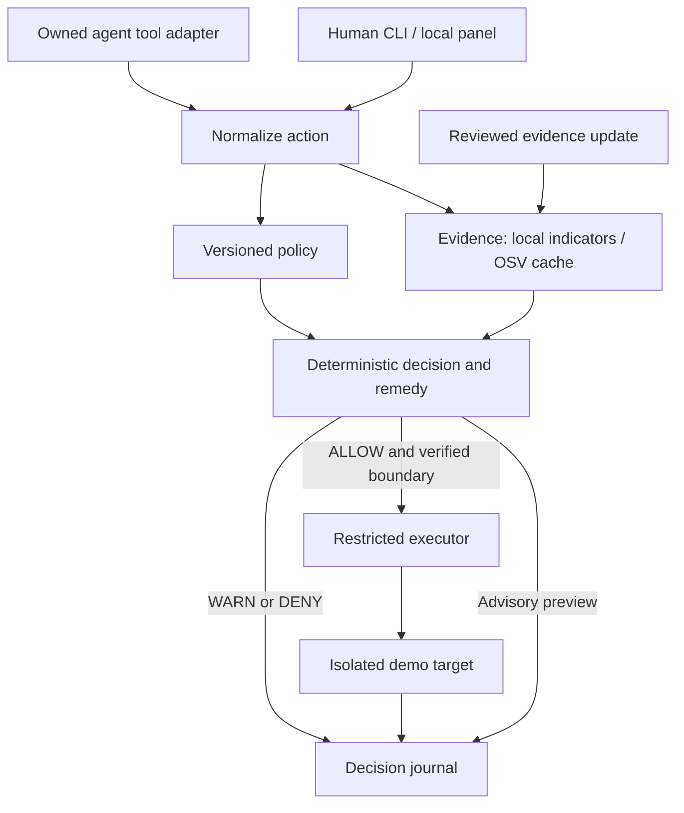

# MIRA v0.1 — Product and technical design

Status: proposed, 2026-11-26. This supersedes the broad v1 concept for the initial public release. Nothing below implies code, integrations or measured protection exist.

## 1. Problem, users and differentiation

Individuals need understandable security advice before visiting a link, adopting a dependency or handing sensitive information to an agent. Teams need a repeatable way to allow useful work, constrain sensitive actions and explain denials. Existing security controls are necessary; MIRA should complement them.

Product hypothesis: an evidence-backed action check plus a compliant next step can reduce repeated review and improve safe task completion compared with static policy or an advisory-only lookup. The differentiator to test is a shared, approachable human/agent workflow, a small auditable decision contract, and recovery with updated evidence. None of these is claimed to be unprecedented.

Personal mode: local configuration, CLI/local web UI, own checks and receipts, no account. Team pilot: a security owner supplies versioned policies/evidence, reviewers see authorized sanitized receipts, developer tools consume the same contract. Central identity, policy distribution and multi-tenant deployment are later milestones; v0.1 is single local workspace, not an enterprise-ready service.

## 2. Scope freeze

P0: local CLI; small local web UI (one check screen, one evidence/decision history screen); core Python evaluator; SQLite evidence and decision journal; YAML declarative rule schema; controlled adapter and demo targets; reviewed local indicators, opt-in OSV exact package-version queries, offline fixtures; policy/knowledge update and revocation; deterministic remediation; test and benchmark harness.

P1: one tested CLI pre-tool hook or MCP adapter, optional browser extension using explicit page selection and declarative exact-match blocking, one optional semantic classifier, shared policy distribution, existing gateway/OPA integration. Scope each separately and preserve native security.

P2: managed egress, enterprise SSO/RBAC, approved team-wide telemetry, QR advisory, additional feeds and optional model training. No production payment/merchant assessment without authorized identity/payment data. No global domain score, automatic scanner, custom JEV training, embeddings, vector database, graph, cloud LLM, arbitrary web fetch or universal HTTP proxy in P0.

## 3. Core and deployment

Five modules: Action Normalizer, Evidence Engine, Policy Engine, Decision & Safe Resolution, Decision Journal. The execution adapter is the independent boundary, not the model. Use Python 3.12 candidate, FastAPI/Pydantic for typed API, SQLite migrations, simple local HTML or lightweight frontend, pytest, Docker Compose only for the isolated target/runner. Pin and record versions after implementation. Bind web UI to loopback and protect state-changing routes against cross-origin/CSRF abuse; no public server or multi-tenant promise.



For a human preview, ALLOW means "permitted by this policy given available evidence", not executed and not safe in absolute terms. For the agent, the adapter owns actual dispatch and independently validates the exact action. Agents cannot access target directly; enforce by isolated network and target credentials held only by executor. No arbitrary shell, general HTTP client or raw URL fetching. Targets are registered symbolic IDs with fixed destination/method and allowlisted schemas. No redirects in demo. Scope includes only these mediated tools.

## 4. Three core workflows

| Workflow | Input | Decision and next step |
|---|---|---|
| Check URL | User-entered URL; no automatic visit or lookup of private URLs | Exact reviewed indicator match DENY recommendation; unknown/stale WARN; only explicitly approved scope may ALLOW; show evidence coverage and no guarantee |
| Check dependency | Ecosystem, package name, exact version | OSV affected-version evidence + local policy; deny or warn per explicit rule; propose recorded fixed version only when available, re-check candidate, never install automatically |
| Guard agent action | Registered tool, typed arguments, authenticated local scope, destination ID | Hard deny prohibited destination or secret transfer; warn on required approval; permit scoped benign read/send; show a safe alternative |

The URL checker is advisory and uses local indicators in P0; no live global phishing-detection claim. OSV is not a URL reputation service. Package checks evaluate the specified version only; no package name-only vulnerability claims. Synthetic QR/merchant examples removed from MVP. User reports can create local notes or personal rules but cannot become verified external facts without review.

## 5. Decision contract

Action input (example only):
```json
{"schema_version":"1","actor":"local-agent","tool":"send_report","destination_id":"demo-approved","data_class":"internal","scope_id":"report-task","args":{"report_ref":"report-001"}}
```
Actor, scope, tool schema, data classification floor and destination mapping are resolved server-side from the local adapter and policy. Untrusted metadata may increase risk, never grant privileges. Validate supported schemes and canonical URL components; match exact host/path according to explicit indicator scope, no substring matching. Reject ambiguous input, embedded credentials and unsupported forms.

Decision output (synthetic example):
```json
{"decision_id":"demo-001","decision":"DENY","execution_state":"NOT_EXECUTED","reason_code":"SECRET_EGRESS","policy_version":"demo-v1","knowledge_version":"fixture-v1","rule_ids":["R-003"],"evidence_ids":["fixture-canary-01"],"evidence_status":"MATCHED","explanation":"A protected credential pattern was detected before sending.","remediation":{"type":"REDACT_AND_RECHECK"},"synthetic":true}
```
Evidence record: source ID, native advisory/indicator ID, matching scope, canonical value (or redacted identifier), retrieved/observed timestamps, validity, source URL, hash of normalized source record, fixture flag, verification state and version. Separate fact (e.g. advisory matches package version), inference (risk), authorization (policy), unknown (unavailable/stale). Never fabricate CVE or source links.

Decision order: invalid identity/action/unknown protected tool DENY; hard scope or secret violation DENY; verified indicator/advisory rule DENY/WARN according to explicit scope and policy; required approval, unavailable required evidence, uncertainty WARN (hold); ALLOW only if all required checks pass and scope permits. WARN is not execution. A hard DENY cannot be overridden. Approval only if explicitly allowed; bind one-time nonce, authenticated approver, action digest, policy/knowledge versions, TTL. Recheck exact action and current versions before dispatch, invalidate pending approvals on changes. If approval not implemented, hold and stop. If policy/required evidence/audit unavailable, do not execute protected actions. Crash after dispatch may leave UNKNOWN outcome; no automatic retry of side effects.

## 6. Intelligence and CVE

Start with OSV API (https://google.github.io/osv.dev/api/), opt-in; package name, ecosystem and version leave device, no prompts, paths, code or credentials sent. Keep version-specific provenance and source links, record successful/failed retrieval separately; stale cache does not silently become fresh. Exact advisory match plus local rules; use official affected ranges or a known-good ecosystem comparator, never lexical version comparison. CVE identifies a vulnerability, CVSS severity is not authorization, EPSS/KEV may prioritize later. No CVE matches does not establish a package is safe.

Local indicator bundles are reviewed explicitly and versioned; synthetic example domains use reserved names and no outbound requests. Stage update, schema validate, scope review, atomically publish new immutable snapshot, retain digest and previous version, invalidate decision/approval cache, record rollback/revocation. No arbitrary website scanning or feed scraping. No automatic deny based on LLM summary or community votes. Verify upstream license and redistribution terms before bundling data; use connectors or synthetic fixtures rather than mirroring unclear datasets. No telemetry by default.

## 7. Safe Resolution and optional AI

Use structured rules first: secret egress -> remove secret locally or propose approved destination; vulnerable version -> candidate patched version from advisory, then fresh check; unapproved destination -> approved resource or request scoped access; unknown link -> independently verify through official channel. Every suggested action is a new check. Do not mutate or execute on behalf of the user silently.

An optional future JEV/SLM may classify ambiguous content and draft a human-friendly explanation from evidence IDs. It must have no authorization power, no write access to policy or evidence, no execution credentials; schema and evidence ID validation required. Compare against template explanations before training. LLM absence or failure must not weaken hard controls. No numerical trust score until calibrated with a representative ground truth; display evidence status MATCHED / NO_MATCH / UNKNOWN / STALE, coverage and scope instead.

## 8. APIs, storage and implementation order

Proposed interfaces: local CLI `mira check-url`, `mira check-package`, `mira preview`, `mira demo`, `mira evidence import`; endpoints POST /v1/check, POST /v1/execute (owned adapter only), POST /v1/approvals/{id} (if implemented), GET /v1/decisions/{id}, GET /v1/evidence/{id}. Commands are planned, not currently usable. SQLite tables: policy_versions, evidence_versions, evidence_records, decision_events, execution_receipts, approval_requests. Use migrations and atomic writes. Minimize event logs, omit raw secrets and low-entropy secret hashes; record redacted category, opaque ID and approved metadata. Default retention proposal 30 days, configurable with local deletion/export; no promise of tamper-proof log. Journal integrity relies on local host; signed/externally anchored receipts are future work.

Milestone A: schemas, deterministic rules, local synthetic fixtures, CLI preview; gate tests for scope and unknown evidence. B: isolated target and adapter with actual ALLOW/DENY/WARN side-effect verification, secret canary and bypass tests. C: OSV opt-in and versioned updates, cache freshness/revocation tests, deterministic resolution. D: local panel and reproducible benchmark, documented limitations and setup. Optional integrations only after all gates. Estimated effort is deliberately not fixed before engineering spike. See VALIDATION.md.

## 9. Reviewed prior art (2026-11-26)

- [OWASP AI Agent Security Cheat Sheet](https://cheatsheetseries.owasp.org/cheatsheets/AI_Agent_Security_Cheat_Sheet.html): independent tool-boundary checks and least privilege.
- [Pipelock](https://github.com/pipelab-org/pipelock): egress/MCP security and signed receipts; candidate integration instead of rebuilding firewall.
- [Microsoft Agent Governance Toolkit](https://github.com/microsoft/agent-governance-toolkit): agent governance, trust, policy and approval.
- [Agentgateway](https://github.com/agentgateway/agentgateway): MCP/A2A proxy, authorization, observability.
- [OPA](https://www.openpolicyagent.org/docs): established policy-as-code; simple local evaluator now, adapter later if needed.
- [OSV-Scanner](https://github.com/google/osv-scanner) and [OSV API](https://google.github.io/osv.dev/api/): reuse established advisory tooling rather than a CVE crawler.
- [Progent](https://arxiv.org/abs/2504.11703): per-task privilege controls; no novelty claim for context policy.
- [AgentDojo](https://github.com/ethz-spylab/agentdojo): external evaluation candidate.
- [Chrome declarativeNetRequest](https://developer.chrome.com/docs/extensions/reference/api/declarativeNetRequest): optional scoped blocking, not arbitrary per-request AI.
These are documentation-level comparisons, not installed or tested dependencies. Before adopting code, pin versions, verify licenses and dependencies, test security boundaries and document compatibility.

## 10. Business validation and release

Interview 5–10 consenting personal developers and security reviewers (proposed sample), measure current time to check package/link and to resolve a blocked legitimate task. Compare MIRA to existing workflow, ask whether evidence is understandable and remediation actionable. Track task completion, unsafe effects, false blocks, review time and adoption; no assumed incidents prevented, ROI or enterprise endorsements. Use synthetic scenarios for public demo; organization pilot only after explicit approval, data minimization and ownership review. No proprietary data, real private domains, company policies or internal contest details in public repository.
